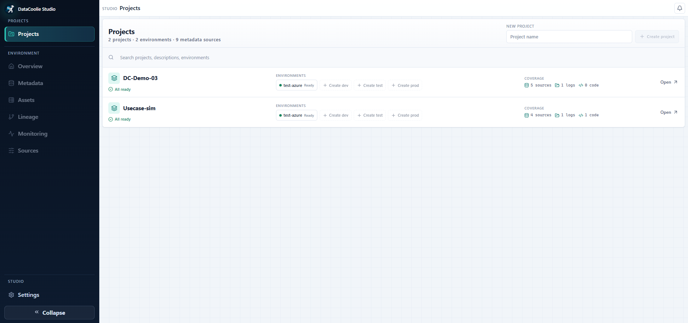

# DataCoolie Studio — Visual Metadata, Lineage, Sources, and Monitoring

**DataCoolie Studio** is the local-first visual companion to the DataCoolie ETL
framework. Use it to organize projects and environments, edit pipeline metadata,
trace lineage, inspect assets, connect storage, and investigate ETL runs from one
web interface.

[Explore DataCoolie Studio on GitHub](https://github.com/datacoolie/datacoolie-studio){ .md-button .md-button--primary }
[Run Studio locally](setup.md#run-studio-locally){ .md-button }

<figure markdown>
  
  <figcaption>Projects brings environment readiness and source coverage into one workspace.</figcaption>
</figure>

!!! info "Beta: install with pip"
    DataCoolie Studio is currently beta software and requires Python 3.11 or
    newer. Follow [Studio setup](setup.md#run-studio-locally) to install and
    launch the published package.

    Review the repository before using Studio with production metadata or
    shared infrastructure.

## DataCoolie and Studio work together

DataCoolie remains the execution framework. Studio makes its files, lineage,
and operational evidence easier to explore; it is not a replacement for an ETL
engine or a workflow orchestrator.

| Component | Responsibility |
|---|---|
| **DataCoolie** | Reads declarative metadata and executes ETL with Polars or Spark on local, Fabric, Databricks, or AWS runtimes. |
| **DataCoolie Studio** | Organizes projects and environments, edits metadata, derives assets and lineage, and visualizes execution and system logs. |
| **Source of truth** | Your original JSON, YAML, XLSX, SQL, Python, and log files remain authoritative. Studio keeps local workspace state, cache, and backups, and writes to a source only after an explicit save operation. |

Already have a DataCoolie project? Add its metadata to a Studio environment,
then attach execution/system logs and code artifacts when you need richer
monitoring and lineage.

## Choose a screen by question

Use this map when you know the question you need to answer but not which Studio
page to open.

| Question | Open this page | What you get |
|---|---|---|
| Which projects and environments are ready? | [**Projects**](tour.md#1-projects-organize-workspaces) | Project readiness, environments, source coverage, and quick navigation. |
| What needs attention in this environment? | [**Overview**](tour.md#2-environment-overview-assess-readiness) | Metadata, lineage, monitoring, freshness, and next-action summaries. |
| How is this pipeline configured? | [**Metadata**](tour.md#3-metadata-inspect-and-edit-pipeline-definitions) | Connections, dataflows, schema hints, ordered transforms, and validation issues. |
| What tables, paths, and references exist? | [**Assets**](tour.md#4-assets-inventory-the-data-estate) | Searchable asset inventory, roles, provenance, dependencies, and unresolved references. |
| What is upstream or downstream of this asset? | [**Lineage**](tour.md#5-lineage-trace-relationships-across-files) | Interactive metadata, SQL, and Python relationships with run-status context. |
| Where do metadata, SQL, code, and logs come from? | [**Sources**](tour.md#6-sources-connect-metadata-sql-code-and-logs) | Local or cloud bindings, read/cache status, validation, synchronization, and log refresh. |
| Is the environment healthy overall? | [**Monitoring · Overview**](monitoring.md#7-monitoring-overview-triage-environment-health) | Health KPIs, trends, runtime context, and attention signals. |
| Which job run failed or took too long? | [**Monitoring · Jobs**](monitoring.md#8-jobs-investigate-orchestrated-runs) | Job status, duration, stages, child flows, reconciliation, and drill-in evidence. |
| Which source-to-destination run has a problem? | [**Monitoring · Dataflows**](monitoring.md#9-dataflows-analyze-source-to-destination-execution) | Phase timing, workload, watermarks, and source/destination context. |
| Are failures repeating or spreading? | [**Monitoring · Failures**](monitoring.md#10-failures-find-repeated-causes-and-blast-radius) | Failure categories, signatures, blast radius, endpoints, and stages. |
| Is data stale or is a watermark stuck? | [**Monitoring · Freshness**](monitoring.md#11-freshness-inspect-age-and-watermark-movement) | Check age, stale signals, watermark coverage, movement, and skip streaks. |
| Where is runtime spent? | [**Monitoring · Performance**](monitoring.md#12-performance-locate-runtime-pressure) | Duration distributions, bottleneck phases, throughput, and optimization candidates. |
| Which workloads read or write the most? | [**Monitoring · Volume**](monitoring.md#13-volume-understand-workload-and-storage-change) | Rows, bytes, files, workload mix, storage deltas, and high-volume candidates. |
| Is table maintenance effective? | [**Monitoring · Maintenance**](monitoring.md#14-maintenance-verify-table-care-outcomes) | Maintenance health, reclaimed storage, removed files, and destination efficiency. |
| Can the monitoring evidence be trusted? | [**Monitoring · Diagnostics**](monitoring.md#15-diagnostics-validate-monitoring-evidence) | Job linkage, reconciliation, evidence completeness, and cache/source warnings. |
| How is Studio itself configured? | [**Settings**](tour.md#settings-configure-studio-itself) | Timezone, source checks, workspace database, caches, diagnostics, and capability modules. |

!!! note "Screenshot coverage"
    This overview, the [interface tour](tour.md), and the
    [monitoring guide](monitoring.md) include **15 representative workflow screenshots** maintained in
    the DataCoolie Studio repository. They show the current navigation and page
    surfaces using a local workspace; source health and monitoring values vary
    with the workspace data. Settings is documented from the shipped source but
    does not yet have a screenshot. The capability-gated Master Data route is a
    placeholder, so it is not presented as an operational feature.

## What you can do in Studio

-   :material-table-edit: **Edit pipeline metadata**

    ---

    Work with JSON, YAML, and XLSX metadata in a structured editor. Studio
    validates changes and creates a backup before replacing the original file.

-   :material-source-branch: **Explore assets and lineage**

    ---

    Discover assets and trace upstream or downstream relationships inferred
    from metadata, SQL, and Python evidence without creating merged metadata.

-   :material-chart-timeline-variant-shimmer: **Investigate execution operations**

    ---

    Review jobs, dataflows, failures, diagnostics, performance, volume,
    maintenance, and freshness from execution and system logs.

-   :material-cloud-outline: **Connect where your project lives**

    ---

    Read from local storage, Amazon S3, MinIO, ADLS, OneLake, Google Cloud
    Storage, or Databricks. Cloud credentials use the operating-system
    credential store.

## Product tour and detailed guide

[Product tour and detailed guide](tour.md#product-tour-and-detailed-guide).

[1. Projects — organize workspaces](tour.md#1-projects-organize-workspaces).

[2. Environment Overview — assess readiness](tour.md#2-environment-overview-assess-readiness).

[3. Metadata — inspect and edit pipeline definitions](tour.md#3-metadata-inspect-and-edit-pipeline-definitions).

[4. Assets — inventory the data estate](tour.md#4-assets-inventory-the-data-estate).

[5. Lineage — trace relationships across files](tour.md#5-lineage-trace-relationships-across-files).

[6. Sources — connect metadata, SQL, code, and logs](tour.md#6-sources-connect-metadata-sql-code-and-logs).

## Monitoring — choose the focused operational page

[Monitoring — choose the focused operational page](monitoring.md#monitoring-choose-the-focused-operational-page).

[7. Monitoring Overview — triage environment health](monitoring.md#7-monitoring-overview-triage-environment-health).

[8. Jobs — investigate orchestrated runs](monitoring.md#8-jobs-investigate-orchestrated-runs).

[9. Dataflows — analyze source-to-destination execution](monitoring.md#9-dataflows-analyze-source-to-destination-execution).

[10. Failures — find repeated causes and blast radius](monitoring.md#10-failures-find-repeated-causes-and-blast-radius).

[11. Freshness — inspect age and watermark movement](monitoring.md#11-freshness-inspect-age-and-watermark-movement).

[12. Performance — locate runtime pressure](monitoring.md#12-performance-locate-runtime-pressure).

[13. Volume — understand workload and storage change](monitoring.md#13-volume-understand-workload-and-storage-change).

[14. Maintenance — verify table-care outcomes](monitoring.md#14-maintenance-verify-table-care-outcomes).

[15. Diagnostics — validate monitoring evidence](monitoring.md#15-diagnostics-validate-monitoring-evidence).

## Settings — configure Studio itself

[Settings — configure Studio itself](tour.md#settings-configure-studio-itself).

## Recommended investigation workflow

1. Open **Overview** and identify the affected area.
2. Confirm metadata, SQL, code, and log currency in **Sources**.
3. Use **Metadata** or **Assets** to find the definition and affected object.
4. Trace impact in **Lineage**.
5. Triage run health in **Monitoring Overview**.
6. Move to the focused Monitoring page that matches the symptom.
7. Check **Diagnostics** before concluding that missing evidence means healthy
   or failed behavior.

## Run Studio locally

[Run Studio locally](setup.md#run-studio-locally).

[Add only the cloud integrations you need](setup.md#add-only-the-cloud-integrations-you-need).

[Develop from source](setup.md#develop-from-source).

[Common launcher options](setup.md#common-launcher-options).

[Local workspace](setup.md#local-workspace).

[Create your first workspace](setup.md#create-your-first-workspace).

[Troubleshooting the first workspace](setup.md#troubleshooting-the-first-workspace).

## Frequently asked questions

### Does Studio run my ETL pipelines?

DataCoolie executes the pipelines. Studio currently focuses on project setup,
metadata, assets, lineage, sources, and monitoring evidence. Use your existing
scheduler or orchestrator to decide when ETL jobs run.

### Does Studio overwrite my metadata?

The original metadata remains the source of truth. When you save from the
editor, Studio validates the document and creates a backup before replacing the
file. The write happens only after you explicitly choose **Save to Source**.

### Can Studio work with Fabric, Databricks, and AWS?

Yes. OneLake and ADLS cover Microsoft Fabric storage, Databricks support is
included in the base installation, and the `s3` extra supports Amazon S3. The
Studio repository also provides MinIO and Google Cloud Storage integrations.

## Continue exploring

- [Install the DataCoolie ETL framework](../guide/getting-started/installation.md)
- [Build projects with the official DataCoolie Skills](../introduction/ai-skills.md)
- [Watch the WWI multi-cloud walkthrough](../examples/wwi-medallion-multicloud.md)
- [Understand the DataCoolie metadata model · Mental model](../reference/concepts/metadata-model.md#mental-model)
- [Learn how DataCoolie logging is structured](../guide/operations/logging.md)
- [View the Studio source and report issues](https://github.com/datacoolie/datacoolie-studio)
