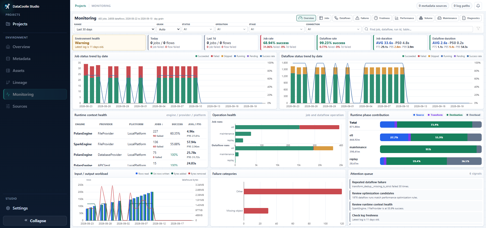
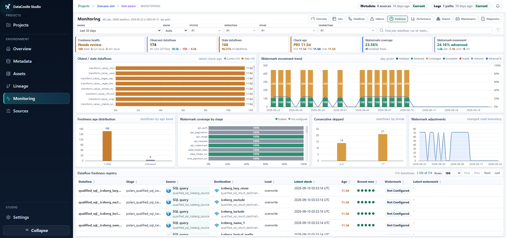
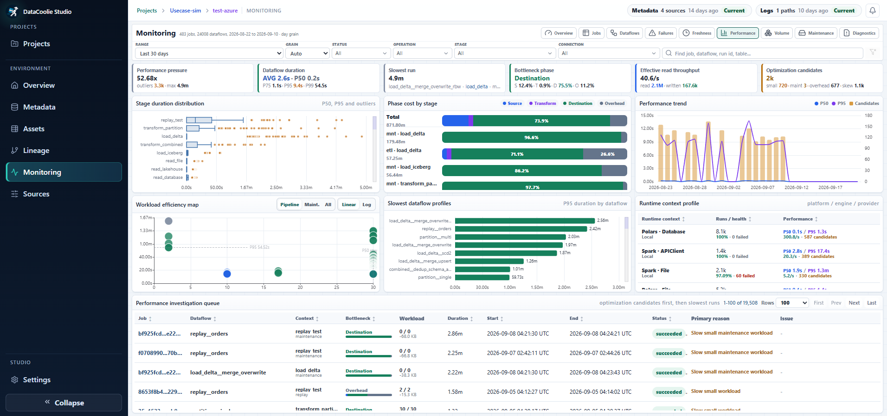
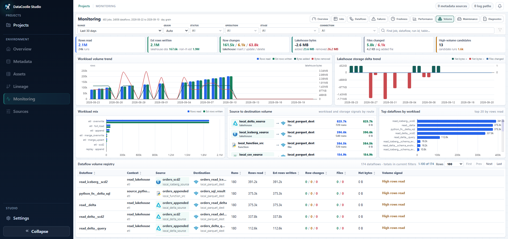
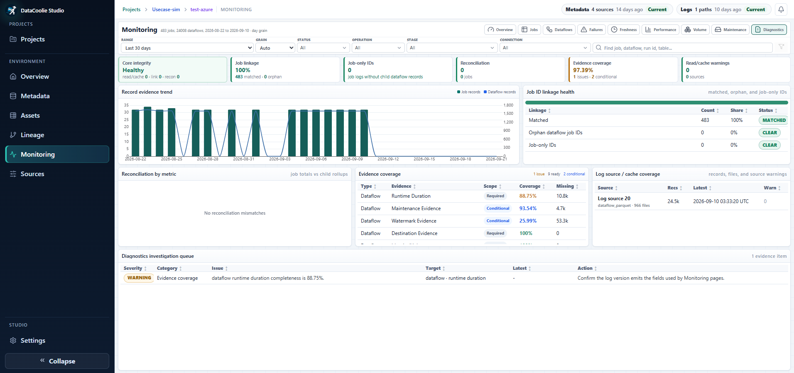

# Investigate runs in Studio

[Studio overview](index.md).

## Monitoring — choose the focused operational page

The monitoring workspace turns DataCoolie execution and system logs into
operational views for run health, failures, diagnostics, duration, data volume,
maintenance, and freshness. Logs are optional, so you can start with metadata
and add monitoring evidence later.

All Monitoring pages share the same command bar. Set the date range and grain,
then filter by status, operation, stage, connection, or search text. Moving
between tabs preserves the environment context so you can follow an issue from
summary to evidence.

### 7. Monitoring Overview — triage environment health

Use Overview at the start of an operational review. It answers whether jobs and
dataflows are succeeding, how run health is trending, and which runtime context
or phase deserves attention.

<figure markdown>
  
  <figcaption>Use the overview for triage, then move into focused monitoring pages for investigation.</figcaption>
</figure>

Look first at health KPIs and attention signals, then follow the related Jobs,
Dataflows, Failures, Performance, Maintenance, Freshness, or Diagnostics page.

### 8. Jobs — investigate orchestrated runs

Jobs summarizes parent runs and their child-dataflow impact. Use it to compare
job success rate and duration, identify failed stages, and open the evidence for
a specific run.

<figure markdown>
  
  <figcaption>Jobs combines run-level health, runtime context, stage impact, duration, fan-out, and drill-in evidence.</figcaption>
</figure>

Use the run table to move from aggregate symptoms to a single job ID. Compare
its stages, child-flow counts, volume, reconciliation state, and issue message.

### 9. Dataflows — analyze source-to-destination execution

Dataflows is the most detailed execution view for individual pipeline steps. It
separates source, transform, destination, and overhead phases while retaining
source/destination, volume, watermark, status, and parent-job context.

<figure markdown>
  
  <figcaption>Dataflows helps isolate the slow or failing phase and the affected source-to-destination route.</figcaption>
</figure>

Use this page when a job summary is too broad. Filter to the dataflow, route, or
stage, then compare phase contribution and the run-level evidence.

### 10. Failures — find repeated causes and blast radius

Failures groups operational errors instead of forcing you to read every run
individually. Use it to spot repeated signatures, the most affected endpoints,
and whether the issue is concentrated in one phase or stage.

<figure markdown>
  
  <figcaption>Failures prioritizes the newest incidents while exposing repeated causes and their operational reach.</figcaption>
</figure>

Start with the latest failed-dataflow queue. If a signature repeats, use its
category, phase, route, and stage distribution to determine whether one fix can
remove several incidents.

### 11. Freshness — inspect age and watermark movement

Freshness answers whether expected data is arriving and advancing. It combines
source check age, stale-data signals, consecutive skips, watermark coverage,
and watermark movement.

<figure markdown>
  
  <figcaption>Freshness separates stale checks from watermark configuration and movement problems.</figcaption>
</figure>

Check whether a dataflow is genuinely stale, merely unobserved, or missing a
watermark configuration. Use the registry to follow a specific dataflow after
the aggregate charts identify an age band, stage, or skip streak.

### 12. Performance — locate runtime pressure

Performance breaks duration into phases and runtime contexts. Use it to find
slow profiles, outliers, throughput pressure, and candidates where optimization
work is most likely to matter.

<figure markdown>
  
  <figcaption>Performance links duration and throughput symptoms to phases, dataflows, engines, platforms, and providers.</figcaption>
</figure>

Use P50 for typical behavior, P95 for tail latency, and outliers for exceptional
runs. Compare source, transform, destination, and overhead contribution before
changing engine, compute, or storage settings.

### 13. Volume — understand workload and storage change

Volume tracks rows, bytes, files, and row changes across the selected period.
Use it to find high-volume dataflows, unusual storage deltas, file churn, or a
route whose read and write behavior no longer matches expectations.

<figure markdown>
  
  <figcaption>Volume connects workload trends and storage impact to operations, routes, and individual dataflows.</figcaption>
</figure>

Read rows and estimated rows written together. For lakehouse destinations, also
review bytes added or removed and files changed so a small logical update does
not hide disproportionate physical churn.

### 14. Maintenance — verify table-care outcomes

Maintenance focuses on optimize, vacuum, and related destination operations.
Use it to confirm coverage, identify no-op or slow work, and compare time spent
with storage reclaimed or files removed.

<figure markdown>
  
  <figcaption>Maintenance shows whether table-care work is healthy and whether its runtime produces useful storage outcomes.</figcaption>
</figure>

Use the destination registry to find lagging or low-efficiency tables. A long
maintenance run with little reclaimed storage can be a scheduling or policy
candidate rather than an engine-performance issue.

### 15. Diagnostics — validate monitoring evidence

Diagnostics checks the evidence behind the other Monitoring pages. Use it when
metrics look incomplete, a job has no child dataflows, reconciliation does not
match, or a log source/cache warning may explain missing results.

<figure markdown>
  
  <figcaption>Diagnostics makes evidence quality explicit before you trust or compare operational metrics.</figcaption>
</figure>

Resolve core-integrity and linkage problems before interpreting higher-level
KPIs. Evidence coverage distinguishes required fields from conditional fields,
helping you decide whether a missing metric reflects a required-field, linkage,
or evidence-coverage problem.
