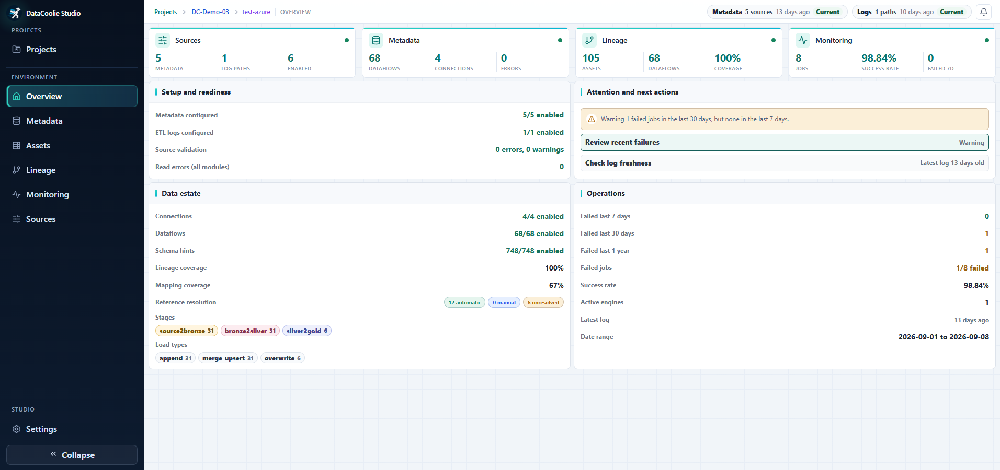
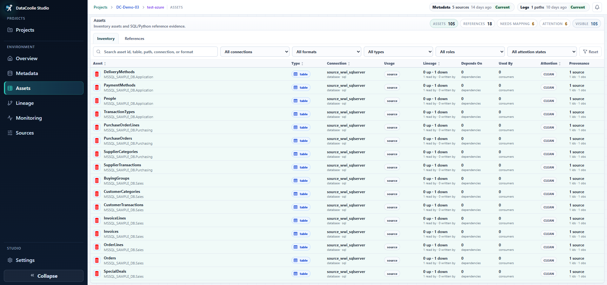

# Studio interface tour

[Studio overview](index.md).

## Product tour and detailed guide

### 1. Projects — organize workspaces

The Projects page is the starting point. A project groups related environments;
  each environment can point to different metadata, SQL, source code, and logs. Use
this page to compare readiness before opening an environment.

The [Studio overview screenshot](index.md) shows the Projects workspace. From
there you can:

- create, rename, or remove projects;
- add environments such as `dev`, `test`, or `prod`;
  - see metadata, SQL, log, and code-source coverage;
- open project-level **Overview**, **Environments**, or **Reference mappings**;
- enter an environment workspace when its sources are ready.

Deleting a Studio environment removes its Studio settings and cached data; it
does not delete the original source files.

Project-level navigation has three focused pages:

| Project page | Use it for |
|---|---|
| **Overview** | Compare setup progress, environment coverage, and the next project-level action. |
| **Environments** | Create, rename, open, configure, or remove `dev`, `test`, `prod`, and custom environments. |
| **Reference mappings** | Review automatic, manual, and unresolved logical references and map them consistently across environments. |

### 2. Environment Overview — assess readiness

Open Overview first when you enter an environment. It combines source status,
metadata counts, lineage coverage, recent run health, and recommended next
actions so you can decide where to investigate.

<figure markdown>
  
  <figcaption>Environment Overview connects setup readiness, the data estate, operational health, and attention items.</figcaption>
</figure>

Use the four summary areas deliberately:

- **Sources** — confirm metadata, logs, and code are current.
- **Metadata and Lineage** — check enabled definitions, parse errors, coverage,
  and unresolved mappings.
- **Monitoring** — scan recent success rate and failures.
- **Attention and next actions** — follow the shortest route to the page that
  can resolve the issue.

### 3. Metadata — inspect and edit pipeline definitions

The metadata workspace presents connections, dataflows, schema hints, and
ordered transforms together. This helps reviewers understand a pipeline before
they run it and catches configuration issues closer to the source. Use search
and filters to narrow large metadata files, then select a definition to inspect
or edit its structured fields.

<figure markdown>
  
  <figcaption>Edit and validate source-defined metadata without hiding the original files.</figcaption>
</figure>

Before saving, verify the selected source and any reported issues. Studio
validates the document and creates a backup before it replaces the original
file. Revision-aware saves also protect against silently overwriting a newer
source revision.

### 4. Assets — inventory the data estate

Assets turns connection and dataflow evidence into a searchable inventory. Use
it when you need to find a table or path, understand whether it acts as a source
or destination, or locate unresolved SQL/Python references.

<figure markdown>
  
  <figcaption>Assets combines inventory, usage, dependency, attention, and provenance evidence.</figcaption>
</figure>

Useful filters include connection, format, type, role, and attention state. Open
an asset when you need its source definitions, observations, consumers, or
reference-resolution context.

### 5. Lineage — trace relationships across files

Studio combines references found in metadata, SQL, and Python for display. Use
filters and upstream or downstream traversal to focus on the part of the graph
you are investigating. Run-status context helps connect a structural
relationship to recent operational evidence.

<figure markdown>
  
  <figcaption>Lineage connects source definitions and code evidence while leaving source files authoritative.</figcaption>
</figure>

Start from a known asset when possible. Expand upstream to investigate where
data came from, downstream to assess impact, or both when reviewing a change.
Reference mappings can resolve logical references that Studio cannot match
automatically across environments.

### 6. Sources — connect metadata, SQL, code, and logs

Sources is where an environment learns what to read. Add a local path or cloud
URI, test access, scan a project, and review validation and synchronization
state. Each source reports whether it is enabled, readable, and current.

<figure markdown>
  
  <figcaption>Sources keeps metadata, SQL, code, and logs separate while exposing validation, synchronization, and refresh state.</figcaption>
</figure>

Use metadata sources for DataCoolie definitions, SQL sources for query files and
roots, code sources for referenced Python functions and dependency analysis, and
log sources for Monitoring. A project scan accepts one project root per scan;
marker files can resolve multiple SQL and code folders, while the fallback
inputs let you add multiple SQL or code folders explicitly. Manual path adds one
path per submit: a metadata folder imports its metadata files, a SQL file or
folder creates one SQL source, and a code path creates one code artifact.

Cache behavior depends on the source kind. Metadata, code, and logs can have
derived materializations; SQL roots are read live and do not build a separate
materialization cache. Cloud metadata and code changes are observed
automatically, local metadata and code are checked on navigation or foreground,
and log sources are observed periodically and synchronized manually or by their
schedule.

Choose the provider that matches where the source lives:

| Platform or location | Studio provider | Installation |
|---|---|---|
| Local filesystem | Local | Base installation |
| AWS | Amazon S3 | `datacoolie-studio[s3]` |
| S3-compatible storage | MinIO | `datacoolie-studio[minio]` |
| Microsoft Fabric | OneLake or ADLS | `datacoolie-studio[onelake]` or `datacoolie-studio[adls]` |
| Google Cloud | GCS | `datacoolie-studio[gcs]` |
| Databricks | Databricks | Base installation |

Cloud credentials are stored through the operating-system credential store.
Use **Test connection** before scanning, then validate and synchronize the
source when its kind supports a materialization. The source remains
authoritative; Studio reads it and keeps only the derived workspace state and
cache it needs.

## Settings — configure Studio itself

Settings is global rather than environment-specific. Use it to review or change:

- Studio timezone and the source of that timezone;
- adaptive source-check intervals and failure-pause behavior;
- the SQLite workspace database location, size, and compaction;
- disposable result and analytics caches, including clear, optimize, and retry
  operations;
- diagnostic information and the `/api/v1` backend prefix;
- credential profiles and capability modules exposed in navigation.

Cache actions target disposable derived data. Read confirmation text carefully
before maintenance actions, especially on a shared database.
